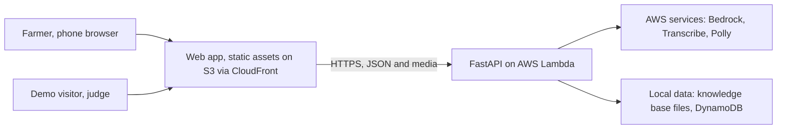
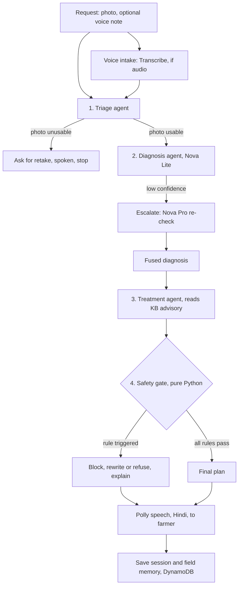
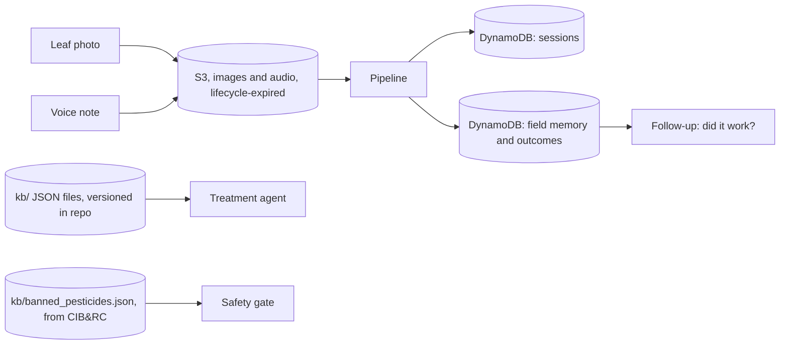
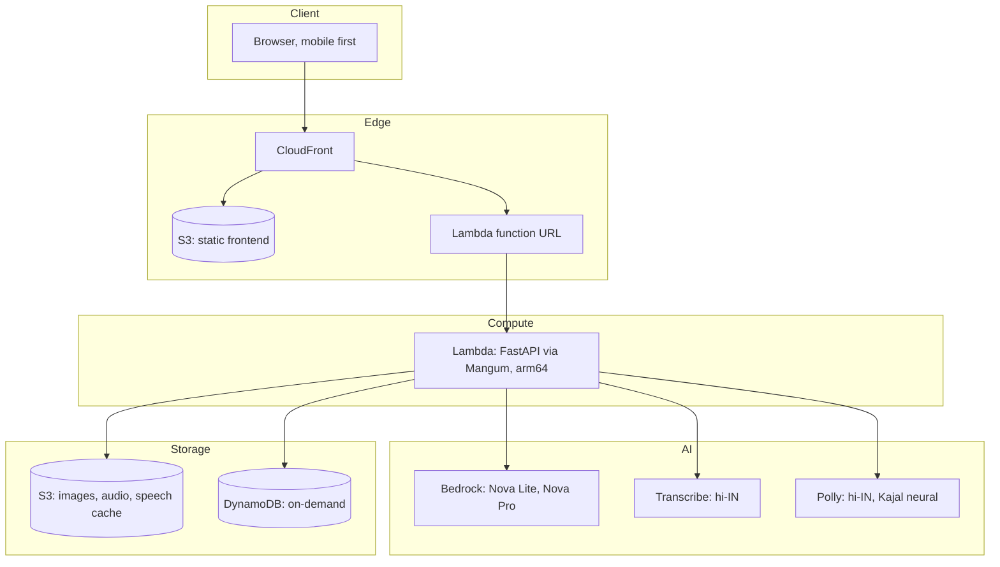
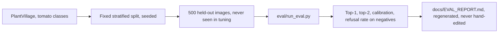

# Architecture

FasalRakshak is a voice-first crop advisory system built on the Strands Agents
SDK and AWS. The design principle is stated once and obeyed everywhere:
**models propose, code decides.** Language models handle perception and
language. Deterministic Python handles every decision that can harm a farmer.

## 1. System context

Two user classes: the farmer, and the judge or evaluator who exercises demo
mode with pre-loaded sample photos and requires no personal data.

## 2. Agent pipeline

Four Strands agents run inside a code-orchestrated pipeline. A model never
routes the request; Python does.

Stage notes:

| Stage | Type | Why |
|---|---|---|
| Voice intake | AWS Transcribe, batch job | Hindi speech to text before routing |
| 1. Triage | Strands agent | Reject unusable photos early, saves cost and farmer time |
| 2. Diagnosis | Strands agent, Nova Lite | Multimodal classification, grounded by KB candidates |
| 2b. Escalation | Nova Pro re-check | Only when confidence is low, bounded cost |
| 3. Treatment | Strands agent | Reads the matched KB entry, drafts plain-language steps |
| 4. Safety gate | Pure Python module | Banned list, dose caps, escalation rules. Not an agent. Cannot be talked around |
| Speech out | Amazon Polly, Hindi | Neural voice, cached per text |

## 3. Data flow

Design choices:

- The knowledge base is versioned JSON inside the repository. Curation is a
  reviewed, diffable change, not a database edit.
- Eval images never enter the repo (`data/` is gitignored). Only derived
  numbers and the script that produced them are published.
- Demo mode reads from a fixed sample set, so judges never touch real
  personal data.

## 4. Deployment topology

Region: `us-east-1`, chosen for model and voice availability. Full detail and
step-by-step deploy: [docs/DEPLOYMENT.md](docs/DEPLOYMENT.md).

## 5. Evaluation methodology

Rules: fixed seed, no cherry-picking, every published number regenerable by
one command. Full plan: [docs/EVAL_PLAN.md](docs/EVAL_PLAN.md).

## Request lifecycle, end to end

1. Farmer opens the app. UI is English chrome, Hindi content, voice-first.
2. She records a short voice note and photographs the leaf. One submit.
3. Transcribe returns Hindi text. Triage validates the image.
4. Diagnosis proposes candidates from the KB, verified by Nova Lite.
5. Treatment agent drafts steps and products from the matched advisory.
6. Safety gate verifies: banned list, dose caps, PHI, PPE, escalation rules.
7. Polly speaks the final plan. Text appears alongside for anyone nearby.
8. Session and field memory persist. A follow-up is scheduled: did it work?

## Failure modes and degraded behavior

| Failure | Behavior |
|---|---|
| Transcribe fails or times out | Text input path remains available |
| Nova Lite unavailable | Nova Pro direct, then Claude fallback on Bedrock |
| KB match below threshold | No treatment spoken. Escalate to agriculture officer |
| Safety gate internal error | Fail closed: spoken answer becomes "show a person this photo" |
| DynamoDB down | Diagnosis still works; memory degrades gracefully, session saved locally and retried |

## Decision records

- [ADR-0001: model choice](docs/adr/ADR-0001-model-choice.md)
- [ADR-0002: orchestration in code, not swarm](docs/adr/ADR-0002-orchestration-in-code.md)
