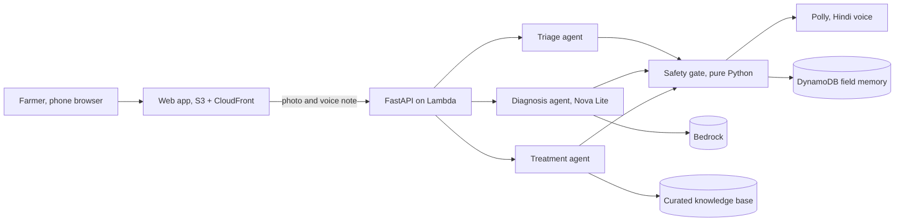

  <strong>FasalRakshak, the crop protector</strong> 
  A crop doctor in every farmer's pocket. 
  Photograph a sick leaf, describe the problem in your own words, and get a
  diagnosis and a safe treatment plan, spoken back in Hindi.

  
  
  
  

> **Status:** in active build. Documentation first, code in tested phases.
> Phase tracker: [docs/PHASES.md](docs/PHASES.md).

## The 30-second version

A tomato farmer in Maharashtra finds brown spots spreading across her leaves.
The nearest agronomist is far away and charges per visit. She opens
FasalRakshak, photographs the leaf, and speaks her problem in Hindi.

Four Strands agents take it from there. Triage checks that the photo is
usable. Diagnosis identifies the disease through Amazon Nova Lite multimodal
inference, grounded in a curated knowledge base of official advisories. The
treatment planner turns the advisory into plain steps. Then, before a single
word is spoken aloud, a deterministic Python safety gate checks every product
and every dose against India's banned-pesticide list and label dose caps.
**Models propose, code decides.** The farmer hears the answer as speech, in
her own language.

## Why this exists

| Reality | What it costs |
|---|---|
| Plant pests and disease destroy up to 40 percent of global crop production (FAO) | Income for the world's 500 million smallholder farms |
| In India, one extension worker serves roughly a thousand farming households | Advice arrives late, wrong, or never |
| Low literacy and language barriers | Text-first apps fail the people who need help most |
| Overt dosing and banned chemicals | Damaged soil, unsafe residue, rejected produce |

FasalRakshak targets the gap between "something is wrong with my crop" and
"here is what I can safely do today", for farmers the current system does not
reach.

## How it works

The pipeline is orchestrated in code, not by a model-led swarm, so every step
is testable and no unsafe output can bypass the gate. Full diagrams:
[ARCHITECTURE.md](ARCHITECTURE.md). Decision records: [docs/adr](docs/adr).

## What makes it trustworthy

- **Fail closed.** If the safety gate cannot verify a treatment, the farmer
  hears "show this to your agriculture officer", never a guess.
- **Cited advice.** Every treatment step names the advisory it came from.
- **Honest numbers.** Accuracy is measured on a fixed, held-out PlantVillage
  benchmark. Every published number is reproducible from
  [docs/EVAL_PLAN.md](docs/EVAL_PLAN.md).
- **Designed for low literacy.** Voice first, simple Hindi, large buttons,
  no typing required.

## Repository map

| Path | What lives there |
|---|---|
| `ARCHITECTURE.md` | System diagrams and component walkthrough |
| `docs/DESIGN.md` | Agent roles, prompts, tool contracts |
| `docs/SAFETY_RULES.md` | The deterministic gate, rule by rule |
| `docs/DATA_SCHEMA.md` | Knowledge base and memory schemas |
| `docs/EVAL_PLAN.md` | Benchmark methodology |
| `docs/API_CONTRACT.md` | HTTP API |
| `docs/VOICE.md` | Speech pipeline and latency budget |
| `docs/DEPLOYMENT.md` | AWS resources and deploy steps |
| `docs/PHASES.md` | Build phases and status |
| `docs/adr/` | Architecture decision records |
| `src/fasalrakshak/` | Agent source, from Phase 3 |
| `kb/` | Knowledge base data, from Phase 1 |
| `eval/` | Benchmark harness, from Phase 6 |
| `app/` | API and web frontend, from Phase 5 |

## Results

Measured on 500 frozen, held-out PlantVillage tomato images against real
Bedrock (docs/EVAL_REPORT.md, reproducible via eval/run_eval.py):

| Metric | Nova Lite (primary) |
|---|---|
| 9-way top-1 | 0.1847 |
| Treatment-family accuracy | 0.6139 |
| Healthy escalation rate | 0.2174 |
| Diagnosis latency p50 | 2141 ms |

We publish the hard numbers, including where the model struggles, because a
safety-first advisory system earns trust with calibration, not marketing.

## Live

Deployed on AWS (Lambda arm64 + API Gateway HTTP API + DynamoDB +
Bedrock): **https://xodqri8mc2.execute-api.us-east-1.amazonaws.com**
Demo mode needs no login and uses no personal data.

## License

MIT. See [LICENSE](LICENSE).
