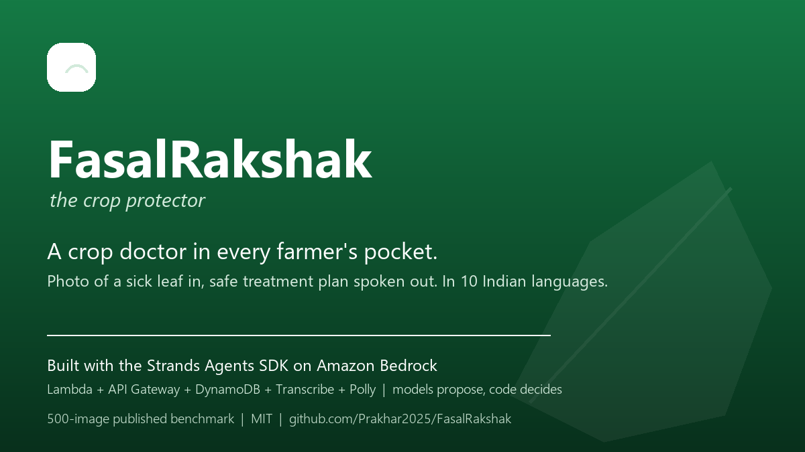
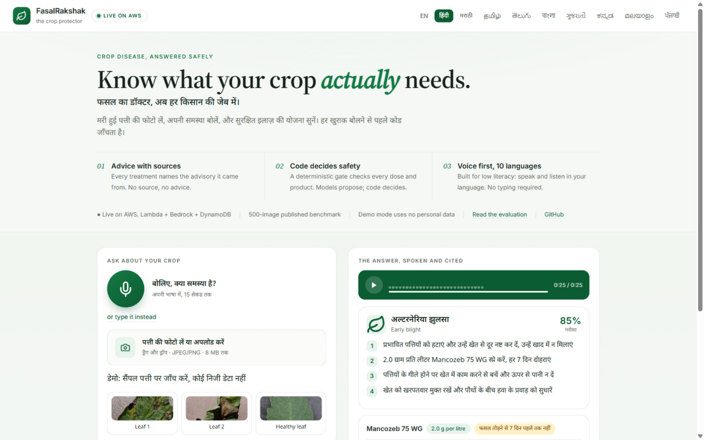
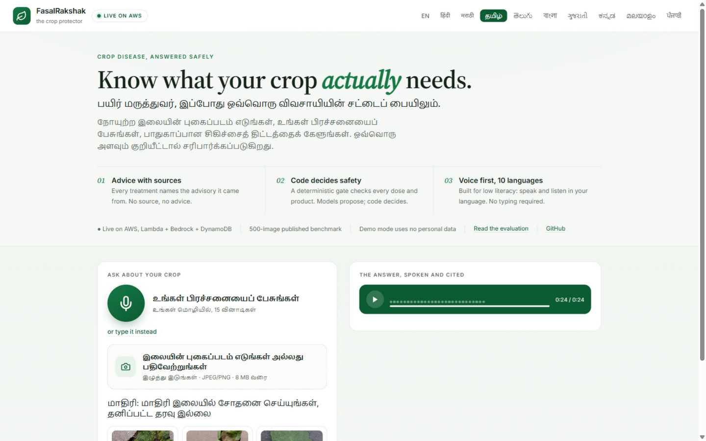
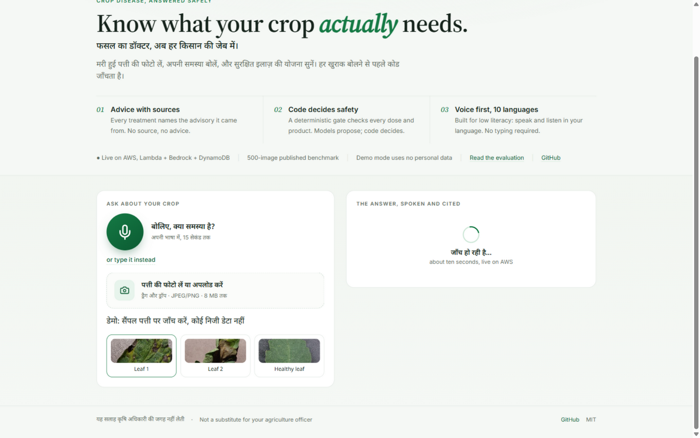
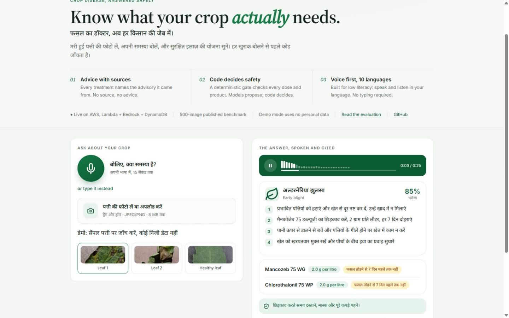
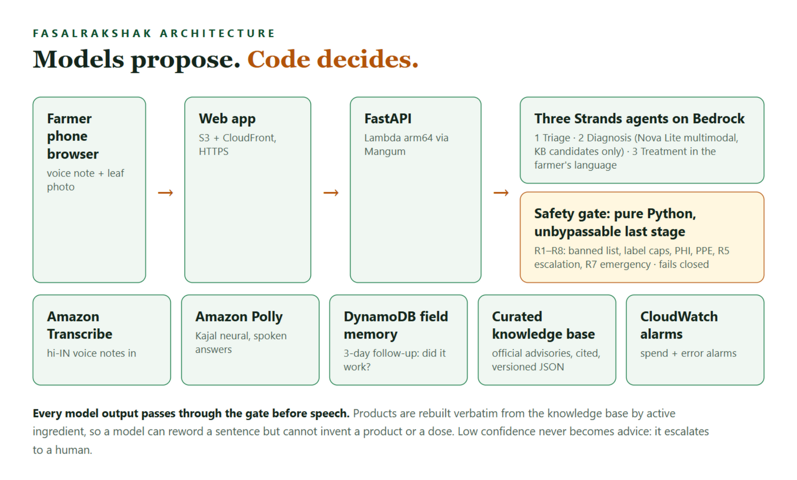
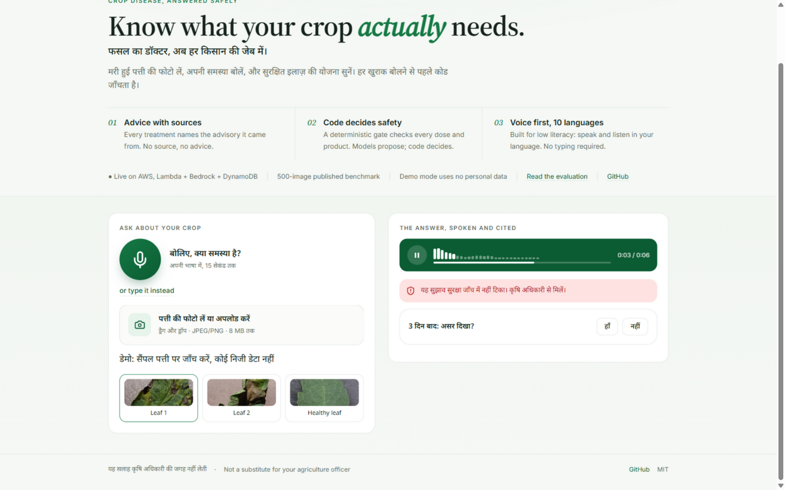
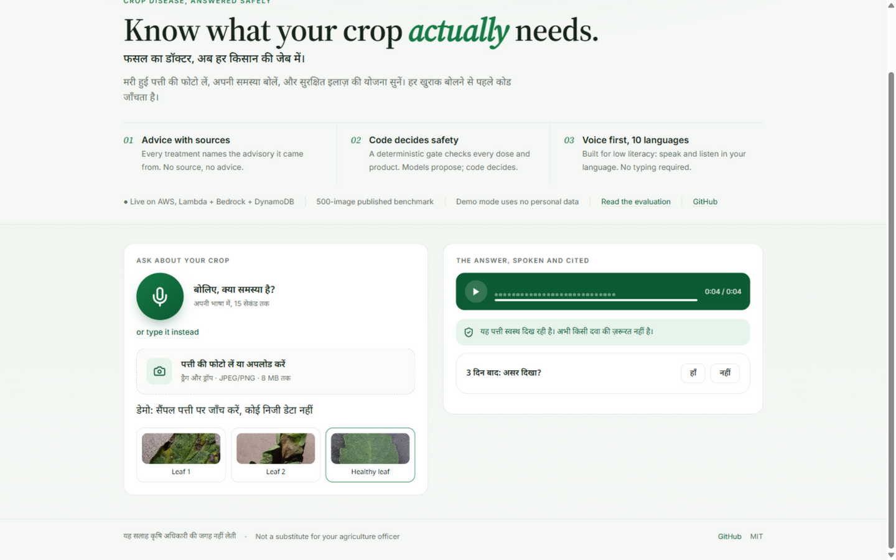

# FasalRakshak: a crop doctor in every farmer's pocket

*A voice-first crop advisory built with the Strands Agents SDK and Amazon
Bedrock for the "Strands SDK: Workshop to Ship" hackathon.*

**Focus area: Climate resilience.** FasalRakshak serves the most
underserved farming households in India, the people who feed the planet
and absorb its first and hardest climate shocks: when heat, erratic rain
and new pest pressure hit a crop, the difference between a treated field
and a lost harvest is whether trustworthy advice arrives in time, in a
language the farmer speaks, at a price she can pay. It is zero.

<!--
Publishing notes (delete this block before publishing):
- The image URLs below point at the raw GitHub files; they render as-is on
  Builder Center if the editor accepts external images. If it prefers
  uploads, drag docs/assets/article/*.png into the editor at the same spots.
- Every screenshot is a real capture from the live deployment; do not
  substitute mocks.
-->

A tomato farmer in Maharashtra finds brown spots spreading across her
leaves. The nearest agronomist is far away and charges per visit. The
internet has articles she cannot read well and apps that want her to type.
Her crop is dying on a clock.

FasalRakshak is built for exactly that moment. She photographs the leaf,
speaks her problem in her own language, and hears a diagnosis and a safe
treatment plan spoken back to her in about ten seconds. Everything flexible
is delegated to models. Everything dangerous is taken away from them. One
principle runs through the whole system: **models propose, code decides.**

This article covers what the product does, one request traced end to end,
how it is built, what we measured, and what we learned. Every number in it
is reproducible from the public repository with one command.

**Try it before you read on** (no login, no personal data):
**https://xodqri8mc2.execute-api.us-east-1.amazonaws.com**

---

## The problem, in numbers

| Reality | What it costs |
|---|---|
| Plant pests and disease destroy up to 40 percent of global crop production (FAO) | Income for the world's 500 million smallholder farms |
| In India, one extension worker serves roughly a thousand farming households | Advice arrives late, wrong, or never |
| Low literacy and language barriers | Text-first apps fail the people who need help most |
| Overt dosing and banned chemicals | Damaged soil, unsafe residue, rejected produce |

Existing tools stop at "here is what your plant might have."
FasalRakshak closes the loop to "here is what you can safely do today, in
your language, with a source you can check."

## What the product does

Open the app on any phone. Three ways in, zero typing required:

- **Speak**: hold the mic and describe the problem in your language. Amazon
  Transcribe (hi-IN) turns the voice note into text.
- **Photograph**: take or upload a photo of the affected leaf (JPEG or PNG,
  up to 8 MB).
- **Demo mode**: three pre-loaded sample leaves, so anyone can judge the
  full system without submitting personal data.

Ten languages are supported end to end: English, Hindi, Marathi, Tamil,
Telugu, Bengali, Gujarati, Kannada, Malayalam and Punjabi. The language
chip changes the interface text, the diagnosis label, the treatment steps
and the voice that reads them aloud.

The answer is not just text on a screen. It is spoken aloud through Amazon
Polly, it carries the official advisory it came from, and it has already
passed a safety gate before a single word is spoken.

One click on the language chip, and the same app speaks Tamil:

## One request, end to end

To show the system honestly, here is what happens when a farmer taps the
first demo leaf and the pipeline runs against live AWS.

1. **Triage (Strands agent, Nova Lite vision).** The photo is checked for
   usability and the crop is hinted. A blurred or non-leaf image stops the
   pipeline here and the farmer hears a polite retake request. No further
   tokens are spent on a photo that cannot be diagnosed.

2. **Diagnosis (Strands agent, Nova Lite multimodal).** The leaf is examined
   against the curated knowledge-base candidates only, with each candidate's
   documented symptoms in context. The model cannot invent a disease: the
   output is constrained to known identifiers with a confidence score.
3. **Treatment (Strands agent).** The official advisory for the identified
   disease is restated for a farmer with low literacy: short sentences, one
   instruction per step, in the farmer's language.
4. **Safety gate (pure Python, no model access).** Every product and dose is
   checked against the CIB&RC banned-pesticide snapshot and label dose caps,
   the pre-harvest interval is verified, mandatory PPE guidance is appended,
   and low-confidence diagnoses are escalated instead of guessed.
5. **Speech (Amazon Polly, Kajal neural).** The final plan is synthesized to
   speech and returned with the response, so the farmer hears it, not reads
   it.
6. **Field memory (DynamoDB).** The session is stored with a follow-up due
   in three days: *did it work?* The outcome feeds back into the system.

The whole voice path is budgeted under 12 seconds (upload and triage 2 s,
transcription 4 s, diagnosis 4 s, treatment and gate 2 s, Polly and
delivery 2 s). The text path skips transcription and targets under 8 s.

And this is what the farmer actually sees: the diagnosis with its
confidence, the plan in plain Hindi, label-verbatim doses with pre-harvest
warnings, the PPE line, the cited source, and the audio player already
speaking the plan aloud.

## How it is built

### Four Strands agents, one code-orchestrated pipeline

| Stage | Model | Job | Why a model |
|---|---|---|---|
| Triage | Nova Lite | usable photo? crop hint? | Perception: judging photo quality is vision work |
| Diagnosis | Nova Lite | which disease, from the KB candidates only | Perception: symptom matching on a leaf image is vision work |
| Treatment | Nova Lite | restate the advisory for low literacy | Language: simplification is language work |
| Safety gate | **none** | verify products, doses, PHI, confidence | **Not** model work: a decision that can harm a farmer |

The orchestration is deliberately a Python function, not a model-led swarm
(ADR-0002). Our stages are strictly ordered and one of them, the gate, must
be unbypassable. A router model could be talked into skipping it. An `if`
statement cannot. This keeps every stage individually testable and the
whole pipeline deterministic in its safety behavior.

The Strands Agents SDK carries the agent loop, the structured-output
handling and the model abstraction (BedrockModel over Nova Lite and Nova
Pro). The agents are brilliant specialists. They are not managers.

### The knowledge base

The KB is curated data, not scraped text: per disease it holds the label in
each language, documented symptoms, the treatment plan, products with
active ingredient, label dose caps, pre-harvest intervals, the source
advisory (state agriculture departments, ICAR), and an organic alternative
list. Products in the final answer are rebuilt verbatim from this data by
active ingredient, so a model can reword a sentence but it cannot invent a
product or a dose.

### The safety gate

Eight deterministic rules stand between the treatment draft and the
farmer's ears (full table with sources: docs/SAFETY_RULES.md):

| ID | Rule | Action |
|---|---|---|
| R1 | Banned or refused-registration ingredient | Remove product, speak the KB organic alternative |
| R2 | Dose above the label maximum | Cap to the label, announce the correction |
| R3 | Pre-harvest interval conflict | Announce PHI, block spraying inside the window |
| R4 | Any chemical treatment | Append mandatory PPE guidance, non-strippable |
| R5 | Confidence below the floor, or top-2 too close | Escalate to the agriculture officer, never guess |
| R6 | Photo unusable | No diagnosis, spoken retake request |
| R7 | Transcript indicates acute human poisoning | Override everything with emergency guidance |
| R8 | Cost fields inconsistent | Block and repair from KB data before speech |

The gate fails closed: if it cannot verify a treatment, the farmer hears
"show this to your agriculture officer", never a guess.

| Danger | Who handles it |
|---|---|
| Inventing a disease | Code: diagnosis chooses only among KB candidates |
| Inventing a product or dose | Code: products rebuilt verbatim from the KB, gate enforces label caps |
| A banned pesticide reaching a farmer | Code: R1, tested at commit time and runtime |
| A wrong guess on a hard photo | Code: R5 escalates below the confidence floor |
| A farmer accidentally poisoned | Code: R7 overrides everything with emergency guidance |
| A confident wrong treatment | The gate: fail closed, human handoff |

Both fail-closed paths are real, captured from the live deployment. An
unsure photo escalates to the agriculture officer instead of guessing, and
a confident "no disease" tells the farmer the leaf looks healthy instead of
reaching for a chemical:

## Running on AWS

The deployment is one idempotent script (`scripts/deploy.py`, boto3 only,
no extra tooling): the private media bucket, two DynamoDB tables, a
least-privilege Lambda role, the arm64 package (code, KB, web assets and
manylinux2014_aarch64 wheels), the function and its Function URL with CORS,
followed by a live smoke test against the public URL.

| Resource | Role |
|---|---|
| S3 + CloudFront | static frontend at the edge, HTTPS only |
| Lambda (arm64, FastAPI via Mangum) | the whole backend |
| Bedrock (Nova Lite primary) | the three vision and language agents |
| Amazon Transcribe (hi-IN) | voice notes in |
| Amazon Polly (Kajal neural, hi-IN) | spoken answers out |
| DynamoDB (on-demand) | sessions and field memory |
| CloudWatch alarms | spend and error alarms |

Estimated infrastructure cost for the whole hackathon window: under USD 2,
dominated by Bedrock tokens during the 500-image benchmark. No secrets live
in the repository; AWS credentials exist only in the environment.

**Engineering quality.** 105 tests run in CI on every push (GitHub
Actions): full HTTP-stack API tests with a fake pipeline, unit tests for
every safety rule in both trigger and clean-pass directions, voice tests
with injected fakes, and property tests that fail the build if any KB entry
ever recommends a banned ingredient or a dose above its own label maximum.

## What we measured

We froze 500 PlantVillage tomato images (50 per class across 9 diseases
plus healthy, fixed seed, demo images excluded) and ran the real diagnosis
stage against real Bedrock. The harness is in the repo (`eval/run_eval.py`);
rerun it and you get these tables.

| Metric | Nova Lite (primary) | Nova Pro |
|---|---|---|
| 9-way top-1 on 500 held-out images | 0.1847 | 0.1982 |
| Treatment-family accuracy (the farmer metric) | **0.6139** | 0.4788 |
| Healthy escalation (should refuse, not guess) | 0.2174 | 0.4894 |
| Diagnosis latency p50 | 2141 ms | 2296 ms |

Why treatment-family accuracy is the farmer metric: the nine confusable
classes collapse into four treatment families (fungal, bacterial, viral,
mite). A Septoria/early-blight confusion changes the label but not the
actionable advice, and every plan still passes the deterministic gate with
label-capped doses. Nova Lite stays the primary model (ADR-0001) because it
wins the farmer-relevant metric, costs less and answers faster; Nova Pro's
better healthy-escalation behavior is covered at the pipeline level by R5.

We also tried three prompt strategies and published all of them
(names-only 0.2222, few-shot reference images 0.1778,
describe-then-classify 0.1333). Zero-shot multimodal diagnosis of nine
confusable tomato classes sits at roughly 20 percent top-1 for both Nova
models, consistent with the known difficulty of fine-grained plant-disease
classification for general-purpose VLMs. The calibration table is flat:
Nova Lite's self-reported confidence does not separate right from wrong on
this benchmark, which is exactly why confidence is treated as a safety
signal for escalation, never as a promise of correctness.

### The honest parts

- PlantVillage photos are laboratory photos: plain background, single leaf.
  Field photos are harder. The benchmark measures the standard public
  dataset, not field conditions, and we say so.
- The leaf-spot family (early blight, Septoria, target spot) is genuinely
  confusable for Nova Lite on lab photos. That is why R5 exists.
- Healthy leaves are scored differently on purpose: the healthy metric is
  the escalation rate, because a confident wrong answer on a healthy crop
  would be the most damaging failure.
- Voice input adds seconds of latency; the text path is the fast path.

The known next step, a supervised classifier distilled from PlantVillage as
a candidate ranker inside the same pipeline, is a configuration change in
this architecture, not a rebuild.

## What we learned

1. **The gate had to exist before the demo could be trusted.** In live
   testing, the treatment model once restated a product name in Hindi. A
   naive name-match would have blocked a safe plan. Because products are
   rebuilt verbatim from the knowledge base by active ingredient, that
   became a repair, not a failure. That single incident is the whole
   "models propose, code decides" argument in miniature.
2. **Agents are staff, not managers.** The orchestration is a Python
   function with an `if` for escalation: testable, cheap, deterministic.
   The Strands agents are brilliant specialists inside it.
3. **Voice is the product.** The moment the Hindi answer plays aloud, the
   system stops being a demo for judges and becomes a tool for a person.
4. **Honest numbers earn trust.** Publishing the confusing classes, the
   flat calibration and the prompt experiments that did not help makes the
   strong numbers believable.

## What is next

- A supervised candidate ranker distilled from PlantVillage, dropped into
  the same pipeline.
- Cotton and other crops as the knowledge base grows with more source
  advisories.
- A WhatsApp channel so the tool lives where farmers already are.
- An offline path for low-connectivity fields.

## Try it

- **Live demo** (no login, no personal data, ten languages):
  **https://xodqri8mc2.execute-api.us-east-1.amazonaws.com**
- **Source code** (MIT): **https://github.com/Prakhar2025/FasalRakshak**
- **Demo video**: linked from the repository README.

Click a sample leaf, and in about ten seconds you will hear the answer.

FasalRakshak. The crop protector.
