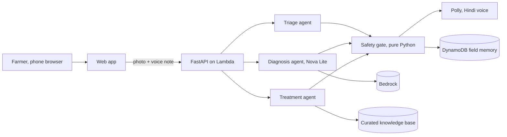

# FasalRakshak: a crop doctor in every farmer's pocket

*Built with the Strands Agents SDK on Amazon Bedrock for the "Strands SDK:
Workshop to Ship" hackathon.*

A tomato farmer in Maharashtra finds brown spots spreading across her
leaves. The nearest agronomist is far away and charges per visit. The
internet has articles she cannot read well and apps that want her to type.
Her crop is dying on a clock.

FasalRakshak is a voice-first web app built for exactly that moment. She
photographs the leaf, speaks her problem in Hindi, and hears a diagnosis and
a safe treatment plan back in Hindi, in about ten seconds. Under the hood,
four Strands agents do the medical work, and one piece of plain Python does
the judging: **models propose, code decides.**

This article explains what it does, how it is built, what we measured, and
what we learned. Every number in it is reproducible from the public repo
with one command.

## The problem, in numbers

| Reality | What it costs |
|---|---|
| Plant pests and disease destroy up to 40 percent of global crop production (FAO) | Income for the world's 500 million smallholder farms |
| In India, one extension worker serves roughly a thousand farming households | Advice arrives late, wrong, or never |
| Low literacy and language barriers | Text-first apps fail the people who need help most |
| Overt dosing and banned chemicals | Damaged soil, unsafe residue, rejected produce |

Existing tools stop at "here is what your plant might have." FasalRakshak
closes the loop to "here is what you can safely do today, in your language,
with a source you can check."

## What it does

Open the app on any phone. Three ways in, zero typing required:

- **Speak**: hold the mic, describe the problem in Hindi or English. Amazon
  Transcribe (hi-IN) turns the voice note into text.
- **Photograph**: take or upload a photo of the leaf.
- **Demo mode**: three sample leaves, pre-loaded, so anyone can judge the
  system without personal data.

Then the pipeline takes over:

1. **Triage agent** checks the photo is usable and hints the crop. A bad
   photo gets a polite spoken retake request, and the pipeline stops before
   spending another token.
2. **Diagnosis agent** looks at the leaf with Amazon Nova Lite (multimodal)
   and chooses among the curated knowledge-base candidates only, with each
   candidate's known symptoms in front of it. It cannot invent a disease.
3. **Treatment agent** restates the official advisory for a farmer with low
   literacy: short Hindi sentences, one instruction per step.
4. **The safety gate** (pure Python, no model access) checks every product
   and dose against India's CIB&RC banned-pesticide snapshot and the label
   dose caps, verifies the pre-harvest interval, appends mandatory PPE
   guidance, and escalates instead of guessing whenever confidence is low.
5. **Amazon Polly** (Kajal, neural, hi-IN) speaks the final plan.

The farmer also gets a follow-up question three days later: *did it work?*
That outcome lands in field memory, which is how advice gets better over
time.

## The principle: models propose, code decides

Everything flexible is delegated to models. Everything dangerous is taken
away from them:

| Danger | Who handles it |
|---|---|
| Inventing a disease | Code: the diagnosis model chooses only among KB candidates |
| Inventing a product or dose | Code: products are rebuilt verbatim from the KB by active ingredient; the gate enforces label caps |
| A banned pesticide reaching a farmer | Code: R1 refuses banned ingredients, tested at commit time and runtime |
| A wrong guess on a hard photo | Code: R5 escalates below the confidence floor, it never becomes advice |
| A farmer accidentally poisoned | Code: R7 overrides everything with emergency guidance |
| A confident wrong treatment | The gate: fail closed, "show this to your agriculture officer" |

The full rule table with sources is in docs/SAFETY_RULES.md. Eight rules,
every one with trigger and clean-pass tests, plus property tests that fail
the build if any knowledge-base entry ever recommends a banned ingredient or
a dose above its own label maximum.

## Architecture in one picture

The Strands Agents SDK carries the agent loop, structured output and model
abstraction. The orchestration is deliberately code, not a model-led swarm
(ADR-0002): our stages are strictly ordered and one of them must be
unbypassable. Fourteen AWS services and resources back it: Bedrock, Lambda
(arm64), API Gateway Function URL, S3, DynamoDB, Transcribe, Polly,
CloudWatch.

## What we measured

We froze 500 PlantVillage tomato images (50 per class across 9 diseases
plus healthy, fixed seed, demo images excluded) and ran the real diagnosis
stage against real Bedrock. Numbers here are produced by eval/run_eval.py;
rerun it and you get the same tables.

| Metric | Nova Lite (primary) | Nova Pro |
|---|---|---|
| 9-way top-1 on 500 held-out images | 0.1847 | 0.1982 |
| Treatment-family accuracy (the farmer metric) | **0.6139** | 0.4788 |
| Healthy escalation (should refuse, not guess) | 0.2174 | 0.4894 |
| Diagnosis latency p50 | 2141 ms | 2296 ms |

We also tried and published three prompt strategies before accepting the
number (names-only, few-shot reference images, describe-then-classify:
0.2222, 0.1778, 0.1333). The full confusion matrix, calibration bands and
method notes are in docs/EVAL_REPORT.md.

### The honest parts

- PlantVillage photos are laboratory photos: plain background, single leaf.
  Field photos are harder. The benchmark measures the model on the standard
  public dataset, not on field conditions, and we say so.
- The leaf-spot family (early blight, Septoria, target spot) is genuinely
  confusable for Nova Lite on lab photos. That is exactly why R5 exists:
  low-confidence and near-tie cases escalate to a human instead of
  guessing. Calibration tables in the report show accuracy per confidence
  band.
- Healthy leaves are scored differently on purpose: a healthy leaf should
  NOT confidently match any disease, so the healthy metric is the
  escalation rate.
- Voice input adds seconds to latency; the text path is the fast path.

## What we learned

1. **The gate had to exist before the demo could be trusted.** In live
   testing, the treatment model once restated a product name in Hindi. A
   naive name-match would have blocked a safe plan. Because products are
   rebuilt verbatim from the knowledge base by active ingredient, that
   became a repair, not a failure. That single incident is the whole
   "models propose, code decides" argument in miniature.
2. **Agents are staff, not managers.** The orchestration is a Python
   function with an `if` for escalation. It is testable, cheap, and
   deterministic. The Strands agents are brilliant specialists inside it.
3. **Voice is the product.** The moment the Hindi answer plays aloud, the
   system stops being a demo for judges and becomes a tool for a person.
4. **Honest numbers earn trust.** Publishing the confusing classes and the
   calibration tables makes the strong numbers believable.

## Try it

Live demo (no login, no personal data, ten languages):
**https://xodqri8mc2.execute-api.us-east-1.amazonaws.com**

Click a sample leaf, and in about ten seconds you will hear the answer.
The repo has the full evaluation harness, the safety rule tables, and every
decision record: **github.com/Prakhar2025/FasalRakshak**

FasalRakshak. The crop protector.
